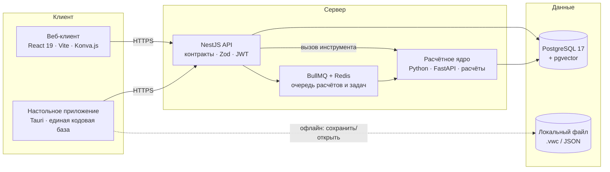

# VoltWireCraft

> **Система автоматизированного проектирования (САПР) электрических сетей
> 0,4 кВ и сборки щитов НКУ со встроенными ИИ-агентами.** Фокус — индивидуальные
> жилые дома (ИЖС), квартиры и коммерческая недвижимость.

**Версия:** `v0.1.0` (подготовка) · **© 2026 RuChating (iilmchat)**

---

## Что это

VoltWireCraft покрывает полный цикл проектирования внутренних электрических
сетей и комплектных устройств:

1. **Загрузка плана помещения** — подложка в форматах PDF, PNG или JPG с ручной
   калибровкой масштаба; векторный разбор DXF/DWG запланирован на `v0.2.0`.
2. **Расстановка ЭУИ и трассировка** — размещение электроустановочных изделий
   (розетки, выключатели, светильники, щиты) на 2D-плане и прокладка кабельных
   линий с привязкой к конструктивам.
3. **Автосборка щита НКУ и однолинейной схемы** — формирование состава щита
   (ВРУ, УЗО, АВДТ), генерация однолинейной схемы с УГО и спецификации.
4. **ИИ-консультант и аудит по ПУЭ-7** — проверка проекта на соответствие
   «Правилам устройства электроустановок» (7-е издание) с пояснениями и
   рекомендациями; расчёты выполняет детерминированное расчётное ядро, а не
   языковая модель.

План этажа и однолинейная схема — не независимые файлы, а две проекции единого
JSON-графа проекта (`ProjectGraphSchema`). Изменение в одной проекции сразу
отражается в другой.

---

## Архитектура



**Принципы связей:**

- все расчёты (сечения кабелей, токи короткого замыкания, номиналы аппаратов
  защиты) идут только в расчётное ядро; ИИ-агент получает результат вызовом
  инструмента и не вычисляет физические величины сам;
- API и ядро обмениваются данными через типизированные контракты, валидируемые
  Zod на границе;
- физические величины хранятся в базовых единицах СИ: `m`, `W`, `V`, `A`,
  `mm2`;
- настольное приложение работает автономно: проект сохраняется в `.vwc`
  (JSON-граф с метаданными) без доступа к сети;
- в `v0.1.0` подложки PDF, PNG и JPG рендерятся и калибруются на клиенте
  (`pdfjs-dist` + Konva.js), все длины хранятся в метрах; разбор DXF/DWG
  вынесен в `v0.2.0`.

---

## Стек технологий

| Слой | Технологии |
|---|---|
| Клиент (веб и настольное приложение) | React 19, Vite, Konva.js, `pdfjs-dist`, Tauri (единая кодовая база) |
| API | NestJS 12, TypeScript (strict), Zod, JWT, Drizzle ORM |
| Расчётное ядро | Python, FastAPI, детерминированные расчёты (разбор DXF/DWG — с `v0.2.0`) |
| Данные | PostgreSQL 17 + pgvector |
| Очереди и фоновые задачи | BullMQ, Redis |
| Инфраструктура | Docker Compose |
| Документация и качество | Markdown (Keep a Changelog), реестр KI-XXX, строгий TypeScript |

---

## Быстрый старт

**Требования:** Docker Desktop, Git. Для локальной разработки — Node.js 22+,
Python 3.12+.

```bash
# 1. Клонировать репозиторий
git clone https://github.com/iilmchat/ai-VoltWireCraft.git
cd ai-VoltWireCraft

# 2. Подготовить переменные окружения
cp .env.example .env

# 3. Поднять PostgreSQL 17 + pgvector, Redis, API и расчётное ядро
docker compose up -d --build

# → API:       http://localhost:3000
# → Веб-клиент: http://localhost:5173
```

Проверка готовности сервисов производится через `docker compose ps` и запрос к
`GET /health`. Подробная настройка и устранение неисправностей будут описаны в
`docs/development/GETTING_STARTED.md` (появляется по мере разработки).

---

## Навигация по `docs/`

| Документ | Для кого | Что внутри |
|---|---|---|
| [RULES.md](docs/development/RULES.md) | разработчики, ассистенты | Правила кода, документации, доменные правила САПР |
| [KNOWN_ISSUES.md](docs/KNOWN_ISSUES.md) | все | Реестр известных проблем и ограничений (`KI-XXX`) |
| [CHANGELOG.md](docs/CHANGELOG.md) | все | История изменений (Keep a Changelog) |
| [DESIGN v0.1](docs/development/v0.1/DESIGN_V010_CORE_AND_PLANNER.md) | разработчики | Дизайн релиза 0.1: графовая модель, подложки, 2D-редактор |

Остальные разделы (руководство пользователя, архитектура, инструкции по
эксплуатации) добавляются по мере выхода релизов.

---

## Лицензия

**Proprietary.** © 2026 RuChating (iilmchat). Все права защищены.
