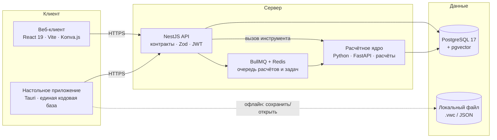

# VoltWireCraft

> **Система автоматизированного проектирования (САПР) электрических сетей
> 0,4 кВ и сборки щитов НКУ со встроенными ИИ-агентами.** Фокус — индивидуальные
> жилые дома (ИЖС), квартиры и коммерческая недвижимость.

**Версия:** `v0.7.0` · **© 2026 RuChating (iilmchat)**

---

## Что это

VoltWireCraft покрывает полный цикл проектирования внутренних электрических
сетей и комплектных устройств:

1. **Загрузка плана помещения** — подложка в форматах PDF, PNG или JPG с ручной
   калибровкой масштаба, векторный импорт DXF и нативная конвертация DWG через
   `dwg2dxf` (LibreDWG) с опциональным `ODA_CONVERTER_PATH`.
2. **Расстановка ЭУИ и трассировка** — размещение электроустановочных изделий
   (розетки, выключатели, светильники, щиты) на 2D-плане и прокладка кабельных
   линий с привязкой к конструктивам.
3. **Детерминированные расчёты** — расчётный ток для одно- и трёхфазных линий,
   потеря напряжения не более 5 %, подбор сечения ВВГнг(А)-LS по ПУЭ-7,
   выбор номинала автоматического выключателя и уставки УЗО, балансировка
   фаз с контролем перекоса не более 15 %, расчёт однофазного тока КЗ
   (петля «фаза-ноль») и проверка токовой селективности.
4. **Автосборка щита НКУ и однолинейной схемы** — группировка потребителей,
   расстановка модулей на DIN-рейках, генерация однолинейной схемы с УГО и
   спецификации кабелей и аппаратов защиты.
5. **ИИ-консультант и аудит по ПУЭ-7** — агенты сборки щита и аудита проекта
   на соответствие «Правилам устройства электроустановок» (7-е издание) и
   СП 256.1325800 с указанием пунктов норматива; все расчёты выполняет
   детерминированное расчётное ядро, а не языковая модель.

**Реализовано в `v0.2.0`:** эндпоинты `POST /v1/calc/line-sizing` и
`POST /v1/calc/auto-panel`, каталог модульного оборудования (IEK, EKF, КЭАЗ),
RAG-по нормативам на `pgvector`, агенты `PanelArchitectAgent` и
`PueAuditorAgent`, четыре проекции графа в интерфейсе — «План помещений»,
«Компоновка щита (НКУ)», «Однолинейная схема» и «Спецификация» — с экспортом
схемы в SVG/PNG/PDF и спецификации в CSV/XLSX. Поддерживаются облачные и
локальные OpenAI-совместимые модели через `LLM_BASE_URL`.

**Реализовано в `v0.3.0`:** импорт DXF-планов через `ezdxf` с нормализацией
стен, расчёт однофазного тока КЗ и селективности (`1,6 · I_n`, исполнение `S`
для вводного противопожарного УЗО), граф `schemaVersion: 2` с координатами
трасс в метрах, автоматическая миграция `.vwc` v1, живой каталог оборудования
в спецификации, нативные диалоги сохранения/открытия проекта в Tauri и CI
с реальным PostgreSQL 17 + pgvector.

**Реализовано в `v0.4.0`:** ИИ-чат-копилот (`POST /projects/:id/ai/chat`)
с предпросмотром патча графа, подтверждением и Undo/Redo; пятая вкладка
«3D-щит (НКУ)» на Three.js; клиентский генератор четырёхлистового комплекта
рабочей документации по ГОСТ Р 21.101 в PDF; «Золотой датасет» из трёх
эталонных объектов и сквозная проверка командой `pnpm smoke:e2e`; полный стек
запускается одной командой `docker compose up -d --build`.

**Реализовано в `v0.5.0`:** трёхфазная автосборка щита 400 В с подбором 3P/4P
аппаратов, реле напряжения на три фазы, УЗО типа `S` и балансировкой L1/L2/L3
с перекосом ≤ 15 %; нативная конвертация `.dwg → .dxf` через LibreDWG в образе
`calc-engine` (или `ODA_CONVERTER_PATH`); MinIO вынесен в Docker profile `s3`,
базовый стек — из пяти сервисов; галерея из шести инженерных шаблонов;
3D-сцена загружается через `React.lazy`. Сквозной прогон `pnpm smoke:e2e`
выполняет **312 проверок по шести кейсам**. Все пункты реестра `KI-001`…
`KI-007` закрыты.

**Реализовано в `v0.6.0`:** многощитовые иерархии `ВРУ → ЩР-1 / ЩР-2`
(`parentPanelId`, `feeder_line`) с каскадной проверкой
$\Delta U_{сумм} \le 5\%$ и переключателем активного щита во всех проекциях;
детерминированный движок время-токовых характеристик кривых B/C/D
(ГОСТ Р 50345 / IEC 60898-1), расчёт предела селективности $I_s$ и проверка
отключающей способности $I_{cn} \ge I_{кз}$ с интеграцией в `PueAuditorAgent`
и интерактивным SVG-графиком ВТХ; седьмой эталон `07_twostory_house_vru_shr`
в золотом датасете и галерее. Сквозной прогон — **379 проверок по семи кейсам**.

**Реализовано в `v0.7.0`:** автообновление десктопного клиента Tauri v2 через
подписанный `latest.json` из GitHub Releases с тихой проверкой при старте,
прогрессом скачивания и перезапуском (при отсутствии сети работа продолжается
в офлайн-режиме); фирменный брендбук IIRuChating `ai-brand` v1.1 — светлая,
тёмная и системная темы на токенах Material 3 (`--md-sys-color-*`),
локальные шрифты Inter/Manrope, логотипы и фавиконы; цвета плана, 3D-щита
и графика ВТХ следуют активной теме.

План этажа, щит, однолинейная схема, спецификация и 3D-щит — не независимые
файлы, а пять проекций единого JSON-графа проекта (`ProjectGraphSchema`).
Изменение в одной проекции сразу отражается в остальных (RULES § 5.2).

---

## Архитектура



**Принципы связей:**

- все расчёты (сечения кабелей, токи короткого замыкания, номиналы аппаратов
  защиты) идут только в расчётное ядро; ИИ-агент получает результат вызовом
  инструмента и не вычисляет физические величины сам;
- API и ядро обмениваются данными через типизированные контракты, валидируемые
  Zod на границе;
- физические величины хранятся в базовых единицах СИ: `m`, `W`, `V`, `A`,
  `mm2`;
- настольное приложение работает автономно: проект сохраняется в `.vwc`
  (JSON-граф с метаданными) без доступа к сети;
- подложки PDF, PNG и JPG рендерятся и калибруются на клиенте
  (`pdfjs-dist` + Konva.js); векторный импорт DXF выполняется в изолированном
  расчётном ядре (RULES § 5.5), DWG — через опциональный конвертер.

---

## Стек технологий

| Слой | Технологии |
|---|---|
| Клиент (веб и настольное приложение) | React 19, Vite, Konva.js, `pdfjs-dist`, Tauri (единая кодовая база) |
| API | NestJS 12, TypeScript (strict), Zod, JWT, Drizzle ORM |
| Расчётное ядро | Python, FastAPI, детерминированные расчёты, `ezdxf` (DWG — через `ODA_CONVERTER_PATH`) |
| Данные | PostgreSQL 17 + pgvector |
| Очереди и фоновые задачи | BullMQ, Redis |
| Инфраструктура | Docker Compose |
| Документация и качество | Markdown (Keep a Changelog), реестр KI-XXX, строгий TypeScript |

---

## Быстрый старт

**Требования:** Docker Desktop, Git. Для локальной разработки — Node.js 22+,
Python 3.12+.

```bash
# 1. Клонировать репозиторий
git clone https://github.com/iilmchat/ai-VoltWireCraft.git
cd ai-VoltWireCraft

# 2. Подготовить переменные окружения
cp .env.example .env

# 3. Поднять PostgreSQL 17 + pgvector, Redis, API и расчётное ядро
docker compose up -d --build

# → API:       http://localhost:3000
# → Веб-клиент: http://localhost:5173

# 4. Сквозная проверка на «Золотом датасете»
pnpm smoke:e2e
```

Проверка готовности сервисов производится через `docker compose ps` и запрос к
`GET /health`. Подробная настройка, устранение неисправностей и описание
сквозного теста — в [GETTING_STARTED.md](docs/development/GETTING_STARTED.md).

---

## Навигация по `docs/`

| Документ | Для кого | Что внутри |
|---|---|---|
| [RULES.md](docs/development/RULES.md) | разработчики, ассистенты | Правила кода, документации, доменные правила САПР |
| [KNOWN_ISSUES.md](docs/KNOWN_ISSUES.md) | все | Реестр известных проблем и ограничений (`KI-XXX`) |
| [CHANGELOG.md](docs/CHANGELOG.md) | все | История изменений (Keep a Changelog) |
| [GETTING_STARTED.md](docs/development/GETTING_STARTED.md) | разработчики, DevOps | Запуск в Docker и прогон `pnpm smoke:e2e` |
| [DESIGN v0.1](docs/development/v0.1/DESIGN_V010_CORE_AND_PLANNER.md) | разработчики | Дизайн релиза 0.1: графовая модель, подложки, 2D-редактор |
| [Золотой датасет](fixtures/golden-dataset/README.md) | QA, разработчики | Три эталонных объекта и контрольные инженерные показатели |

Остальные разделы (руководство пользователя, архитектура, инструкции по
эксплуатации) добавляются по мере выхода релизов.

---

## Лицензия

**Proprietary.** © 2026 RuChating (iilmchat). Все права защищены.
